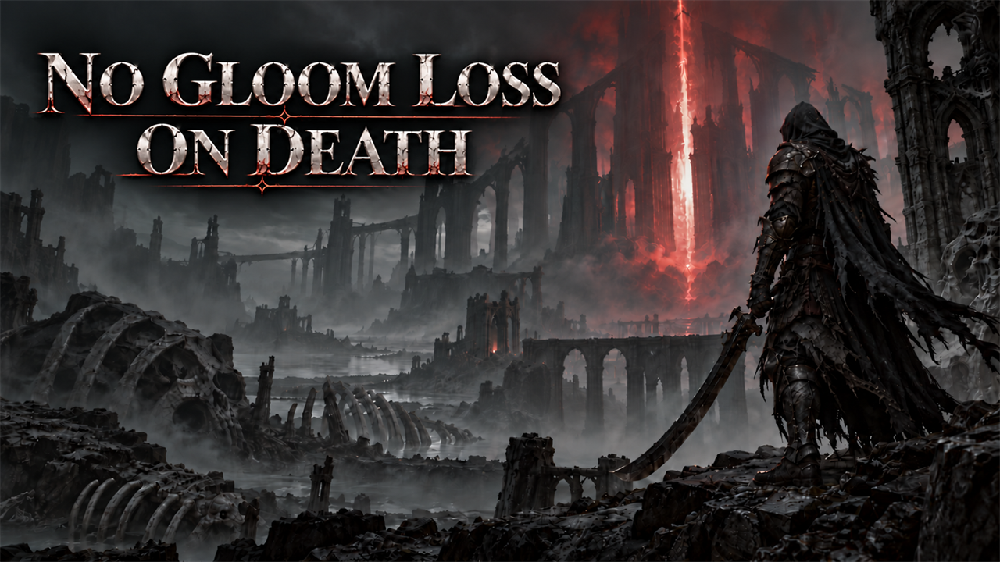

# No Gloom Loss on Death

On death you lose only 10% of your Gloom instead of all of it, and that 10% still drops where you died, so your last death spot stays marked.

## What it does

On death you lose only 10% of your Gloom instead of all of it. A small risk stays, and so does the game's own help:

- The lost 10% drops at the spot where you died, as in the game, so you can go back and pick it up. Your last
  death spot stays marked that way.
- You keep the other 90% when you come back to life.
- The loss is rounded down: with less than 10 Gloom you lose nothing, and nothing drops.
- If you die again before you pick up the lost Gloom, that earlier drop is gone, as in the game.

## Screenshots

## How to install

1. Download the zip of the latest release on GitHub (`mortalshell2_nogloomloss_<version>.zip`).
2. Open the game folder `MortalShell2\Content\Paks\`. If it has no folder `~mods`, create it.
3. Unpack the three files of the zip (`mortalshell2_nogloomloss_P.pak`, `.utoc` and `.ucas`) into `MortalShell2\Content\Paks\~mods\`.
4. Start the game.

To update the mod, replace the three files with the ones of the new release. To remove it, delete the three files.

## How to use

Nothing to do: the mod works as soon as you load a game.

## Compatibility

- Game version: 1.12.0 (`1.12.0`).
- The mod replaces one game file: the death ability `GA_DeathSpoilsHandler`, a Blueprint with game code. A mod that
  replaces the same file conflicts with this one; only one of them works.
- A game update that changes this Blueprint needs a new build of the mod. Until then, the mod puts the older version
  of the Blueprint back; remove the mod after a game update until a new version is out.

## Known issues

None yet.

## How to build

Anyone can build this mod from its source code and check that the download matches it.

1. Install the tools: Windows PowerShell 5.1 (part of Windows), [UAssetGUI](https://github.com/atenfyr/UAssetGUI/releases)
   v1.1.0 and [retoc](https://github.com/trumank/retoc/releases) v0.1.5 in a folder `_tools\uassetgui\` and
   `_tools\retoc\` above the repository (or set `UE5_TOOLS`), and the game's mapping file `MortalShell2-1.12.0.usmap` in
   `%LOCALAPPDATA%\UAssetGUI\Mappings\`. The game must be installed: the build reads the Blueprint's parent class and
   the other game files it uses from it (`structs` in `mod.json`). `README.md` has the details.
2. Build it: `powershell -ExecutionPolicy Bypass -File .\build.ps1`
3. Find the files: `dist\mortalshell2_nogloomloss_P.pak`, `.utoc` and `.ucas`.

## Credits

Made by Kintaro. MIT license: you may use, change and share this mod. Mortal Shell II and its files belong to
their makers; the mod changes only what is listed above.
